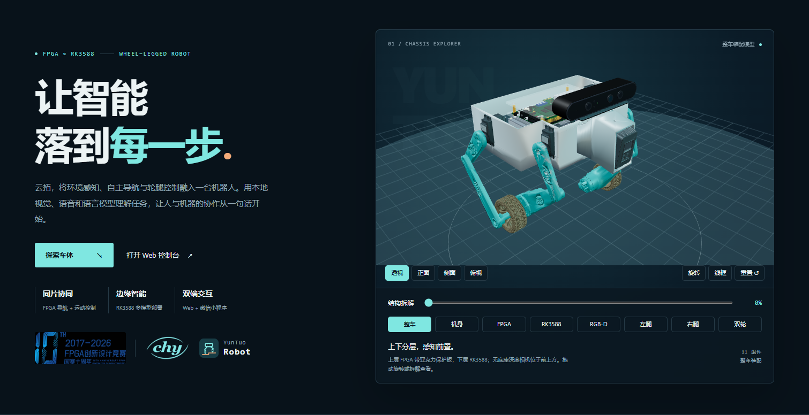
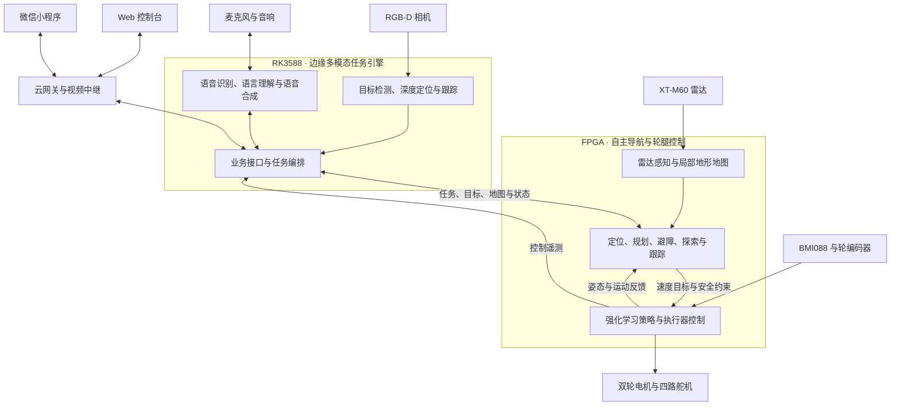

# 云拓 Yuntuo

**FPGA 自主导航与运动控制 · RK3588 边缘多模态任务引擎**

云拓是一套面向室内巡检、目标寻找和人机交互的多模态复杂地形轮腿机器人。项目将雷达感知、地图构建、定位、路径规划与强化学习运动控制集成到同一片 FPGA，并在 RK3588 上部署视觉、语音和语言模型，通过 Web 控制台和微信小程序连接用户与机器人。

两轮自平衡底盘配合四路腿部舵机完成移动与姿态调节。雷达提供环境几何信息，RGB-D 相机识别目标并估计空间位置；导航系统据此规划运动，控制系统将运动目标转换为轮腿动作。

## 交互式项目介绍

[](showcase/index.html)

[下载 HTML 项目介绍](https://github.com/LRaina215/Yuntuo/raw/refs/heads/main/showcase/index.html) · [查看页面文件](showcase/index.html) · [页面使用与维护](showcase/README.md)

下载后用 Edge 或 Chrome 打开，即可离线浏览。页面展示最新整车装配：上层带亚克力保护板的 FPGA、下层 RK3588 和前上方无底座 RGB-D 相机，可旋转、拆解并分别查看设备与轮腿。架构、导航地图、边缘模型、任务流程及双端截图每 2.5 秒自动切换；Web 和小程序截图可点击放大。

介绍页沿用 Web 与小程序的机器人品牌图形，提供滚动入场、视角与拆解过渡，并适配系统的“减少动态效果”设置。

## 访问云拓

**Web 控制台：[lingxunrobot.cn](https://lingxunrobot.cn)**

微信扫描下方小程序码，打开云拓小程序。


## 代码入口

| 部分 | 仓库 | 主要内容 |
|---|---|---|
| FPGA 导航与运动控制 | [SOC_FPGA_NAV · main](https://github.com/LRaina215/SOC_FPGA_NAV/tree/main) | 导航 RTL、软核固件、强化学习控制、同片联合工程、仿真与硬件工具 |
| RK3588、Web 与云端服务 | [QHXD_Web · yuntuo-fpga](https://github.com/LRaina215/QHXD_Web/tree/yuntuo-fpga) | 边缘模型推理、视觉感知、任务编排、Web 控制台、接口网关与视频服务 |
| 微信小程序 | [QHXD_Miniprogram · yuntuo](https://github.com/LRaina215/QHXD_Miniprogram/tree/yuntuo) | 移动端任务操作、语音助手、地图、视频与状态展示 |

本仓库汇集项目介绍、架构文档和各部分代码入口。以上链接直接进入对应的维护分支。

## 主要功能

- **自主导航**：结合雷达、IMU 与轮编码器进行定位，完成定点移动、多点巡检、返航、路径规划和局部避障。
- **地形感知**：维护随机器人移动的局部高程图，分析坡度、高差、粗糙度与落差，生成用于规划的通行代价。
- **视觉找物与跟随**：按类别和颜色筛选目标，结合深度获取三维位置，联动探索、目标接近与人员跟随。
- **自然语言交互**：通过文字或语音表达任务，由本地语言理解服务解析，并以界面状态和语音播报反馈执行过程。
- **轮腿协同控制**：在 FPGA 上运行强化学习策略，结合姿态与轮速反馈生成平衡、移动和腿部调节动作。
- **多端交互**：在电脑和手机上查看地图、视频、任务与设备状态，进行任务下发、暂停、继续、取消和停止操作。

## 系统架构

系统按交互、任务、导航和运动控制分工：Web 与小程序接收用户操作，RK3588 理解任务并提供视觉目标，FPGA 完成环境感知、运动规划和轮腿执行。



### FPGA 自主导航

导航系统部署在高云 GW5AT-LV138 FPGA 上，采用 RTL 加速模块与 PicoRV32 软核协同的结构。RTL 承担点云处理、地图更新、定位匹配打分和轨迹评估；软核固件负责位姿管理、路径搜索、探索策略与导航状态机。

| 模块 | 功能与作用 |
|---|---|
| 雷达感知 | 接收 XT-M60 深度数据，完成点云投影、坐标变换、过滤与栅格化，为地图和定位提供观测 |
| 局部地图 | 维护滚动高程图与历史观测，计算坡度、高差、粗糙度和落差，结合机器人包络生成通行代价图 |
| 定位 | 融合轮里程计、IMU 与结构似然场（SLF）匹配结果，维护机器人位姿及定位质量 |
| 全局路径规划 | 在先验地图或在线累积的记忆栅格上执行 A* 搜索，为定点移动与巡检提供路径引导 |
| 局部规划与避障 | 采样候选速度和轨迹，结合地形代价、机体足迹、目标方向与运动约束选择运动指令 |
| 探索与目标跟踪 | 选择已知区域与未知区域的边界作为探索目标，结合 RK3588 的视觉目标更新搜索、接近和跟随行为 |
| 运动安全约束 | 对输出指令进行限幅、变化率约束和超时管理，处理停止请求与异常状态 |

导航支持两种工作方式：**无先验地图模式**使用运动反馈、局部结构匹配和在线记忆栅格开展定位与探索；**先验地图模式**加载场地地图与初始位姿，进行地图匹配定位、路径规划和重定位管理。两种模式共用局部地形感知与避障链路。

### FPGA 轮腿运动控制

运动控制与导航集成在同一片 FPGA，采用原 4500 强化学习策略，以 125 Hz 运行。策略读取姿态、角速度、轮速、车体运动目标与历史观测，生成左右髋、膝和车轮共六路动作。

腿部动作与高度逆运动学结合，转换为四路舵机指令；车轮动作进入左右轮速度闭环，结合编码器反馈输出电机方向与 PWM。控制侧采集的姿态和运动信息同时提供给导航及遥测服务，连接路径规划与底盘执行。

### RK3588 边缘多模态任务引擎

RK3588 承担视觉感知、语音交互、语言理解和任务编排。模型在机器人本地运行，NPU 执行目标检测与语言模型推理，CPU 处理语音、几何计算和业务逻辑，MPP 硬件编码器负责视频编码。

| 能力 | 模型或实现 | 在系统中的作用 |
|---|---|---|
| 目标检测 | YOLO26n INT8 · RKNN / NPU | 从相机画面中识别人员、水瓶、杯子、球、椅子和背包等任务目标 |
| 目标定位与跟踪 | RGB-D 深度、颜色筛选与目标关联 | 输出目标类别、属性、标识和机身坐标系下的三维位置 |
| 车载语音识别 | SenseVoice INT8 · sherpa-onnx / CPU | 将录音转换为文字，接入任务与对话服务 |
| 语言理解 | Qwen3-1.7B W8A8 · RKLLM / NPU | 解析自然语言意图与任务参数，提供文字交互 |
| 语音合成 | Matcha + Vocos · sherpa-onnx / CPU | 将回复与任务提示转换为语音，交由车载音响播放 |
| 任务编排 | FastAPI + fpga_bridge | 管理定点、巡检、返航、找物和跟随任务，对接 FPGA 协议并汇总执行状态 |

任务引擎将用户意图、视觉目标和导航反馈连接起来。例如“寻找红色水瓶”会被解析为目标类别与颜色条件，视觉服务持续筛选并定位目标，任务桥接协调 FPGA 的探索与接近过程，再将状态返回到界面和语音服务。

### Web 控制台

Web 端采用 Vue 3、TypeScript 与 Vite，面向电脑操作、现场展示和系统调试。

- **地图与导航**：展示场地图、机器人位姿、航点、目标和轨迹，提供地图文件上传、预览与下发进度。
- **任务操作**：配置定点、巡检、找物和跟随任务，查看任务状态，进行暂停、继续、取消、返航和停止操作。
- **视觉与视频**：查看车载画面和检测结果，以 WebRTC 播放视频，并提供 HLS 与检测图片回退。
- **语音与遥测**：通过文字或录音与任务引擎交互，查看姿态、轮速、控制状态、链路信息及事件记录。

### 微信小程序

小程序提供便于随身使用的移动端入口，与 Web 共用 RK3588 业务后端。

| 页面 | 功能 |
|---|---|
| 总览 | 查看当前任务、场地图、相机视频、视觉目标、平台状态与事件 |
| 任务 | 选择目标类别与颜色，发起找物、跟随、定点移动和巡检 |
| 助手 | 通过文字或按住说话发起交互，确认运动指令并查看回复 |
| 我的 | 配置连接地址与访问令牌，查看连接诊断、告警和运行模式 |

小程序使用 HLS 播放车载视频，与 Web 共用同一路云端媒体源；任务状态通过 WebSocket 推送，查询接口提供补充更新。

### 云端接入

云端由 Nginx、Cloud Gateway 和 MediaMTX 组成，提供 Web 页面访问、业务接口转发、访问鉴权、状态推送与视频中继。RK3588 上传一路车载视频，云端向 Web 和小程序提供各自的播放入口。现场也可通过局域网连接 RK3588 后端。

## 获取代码

下载总仓库及各组件：

```bash
git clone https://github.com/LRaina215/Yuntuo.git
cd Yuntuo

git clone --branch main https://github.com/LRaina215/SOC_FPGA_NAV.git components/nav-control
git clone --branch yuntuo-fpga https://github.com/LRaina215/QHXD_Web.git components/rk-web
git clone --branch yuntuo https://github.com/LRaina215/QHXD_Miniprogram.git components/miniprogram
```

各组件独立维护，按对应仓库的说明完成开发环境配置、构建与部署。

## 项目文档

| 文档 | 内容 |
|---|---|
| [总体架构设计](https://github.com/LRaina215/SOC_FPGA_NAV/blob/main/docs/system_architecture.md) | 硬件平台、系统分工、导航控制、模型部署与数据流 |
| [FPGA 接口定义](https://github.com/LRaina215/SOC_FPGA_NAV/blob/main/docs/2_interface/icd.md) | 任务、目标、地图、导航状态与遥测协议 |
| [FPGA 开发指南](https://github.com/LRaina215/SOC_FPGA_NAV/blob/main/docs/3_guide/dev_guide.md) | 导航工程结构、开发环境与验证方法 |
| [RK3588 部署说明](https://github.com/LRaina215/QHXD_Web/blob/yuntuo-fpga/docs/YUNTUO.md) | 模型服务、任务桥接、接口与板端部署 |
| [微信小程序说明](https://github.com/LRaina215/QHXD_Miniprogram/blob/yuntuo/README.md) | 页面功能、开发工具配置与运行方式 |
| [技术方案介绍](presentation/README.md) | 8 页开场介绍 PPT 与页面图片，用于宣讲视频和现场讲解 |
| [仓库组织](docs/repositories.md) | 代码分工、维护分支与文档入口 |
| [开发进展](https://github.com/LRaina215/SOC_FPGA_NAV/blob/main/docs/1_plan/system_integration_plan_20261021.md) · [版本与联调记录](docs/baseline.md) | 开发计划、版本记录与专项测试结果 |
