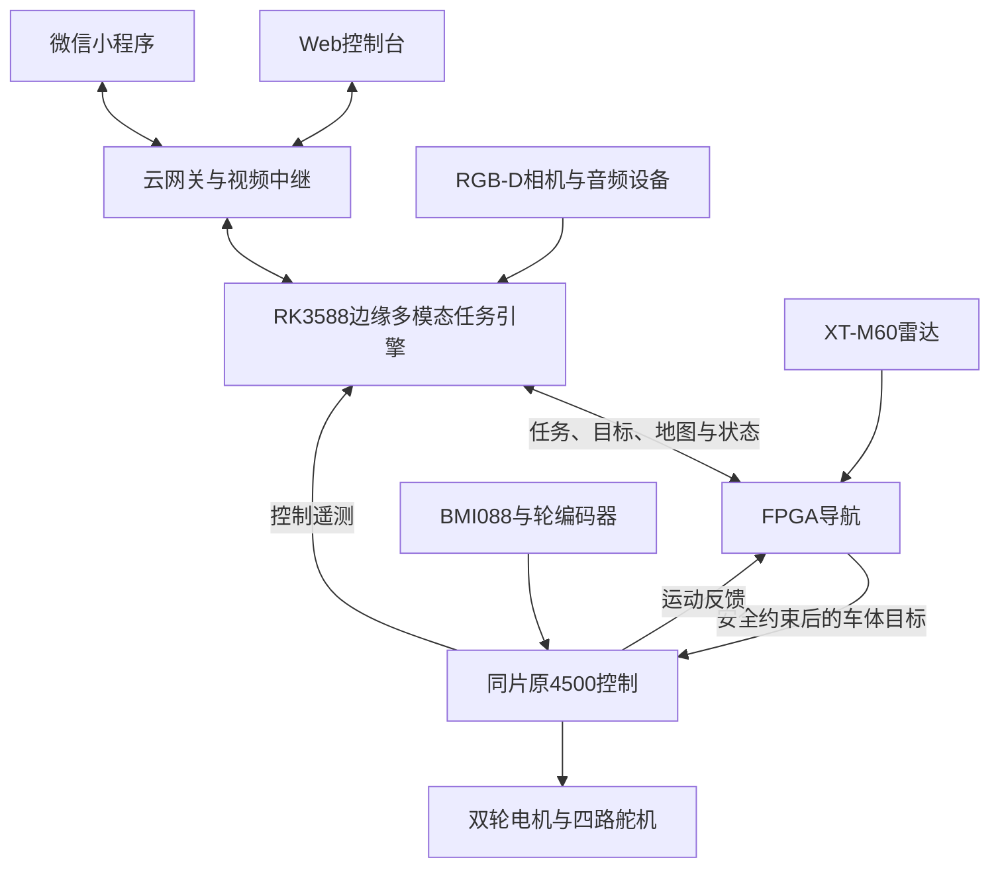

# 云拓 Yuntuo

**FPGA与RK3588边缘协同的多模态复杂地形轮腿机器人。**

这里是云拓项目的总代码入口：集中介绍整车架构，并用Git子模块引用各部分的明确版本。点击下面的目录即可进入对应代码；各部分继续在原仓库维护。

## 代码入口

| 部分 | 本仓库入口 | 开发仓库与分支 | 本次引用版本 |
|---|---|---|---|
| FPGA导航＋原4500运动控制 | [components/nav-control](components/nav-control) | [SOC_FPGA_NAV · codex/integration-g2-20261022](https://github.com/LRaina215/SOC_FPGA_NAV/tree/codex/integration-g2-20261022) | [`45341d4`](https://github.com/LRaina215/SOC_FPGA_NAV/commit/45341d41d76717ff6570077e066dad96d8875485) |
| RK3588服务、Web与云网关 | [components/rk-web](components/rk-web) | [QHXD_Web · yuntuo-fpga](https://github.com/LRaina215/QHXD_Web/tree/yuntuo-fpga) | [`bfb7a34`](https://github.com/LRaina215/QHXD_Web/commit/bfb7a3480809a3d5a5b5d46ade3365392c8ea160) |
| 微信小程序 | [components/miniprogram](components/miniprogram) | [QHXD_Miniprogram · yuntuo](https://github.com/LRaina215/QHXD_Miniprogram/tree/yuntuo) | [`b4be81c`](https://github.com/LRaina215/QHXD_Miniprogram/commit/b4be81c89f78b16d962d1d9467adba60b2ace229) |

**NAV仓库已经包含导航和Control。** 其中`control/`保存原4500的受跟踪副本，`integration/`维护联合工程与候选适配。总仓库不再增加一个并行的Control组件；[Chenyudog/fpga](https://github.com/Chenyudog/fpga)保留为控制来源参考。

总仓库的`main`只组织入口、说明和组件版本。它不会合并或修改组件仓库的`main/master`，也不会让组件自动跟随远端最新提交。

## 系统组成



- **FPGA**：雷达处理、局部地图、定位规划、速度安全约束和原4500轮腿控制，组成同片联合工程。
- **RK3588**：YOLO26n视觉、SenseVoice语音识别、Qwen3-1.7B语言理解、Matcha/Vocos语音合成及任务编排。这是多模型协同系统，未把文本Qwen描述为原生图文VLM。
- **Web与微信小程序**：共用RK业务接口和任务状态；Web主要使用WebRTC，小程序使用HLS，共用同一路云端视频源。

完整设计与接口以组件文档为准，总仓库不复制一套独立维护的总体设计或整车计划：

- [总体架构设计](https://github.com/LRaina215/SOC_FPGA_NAV/blob/codex/integration-g2-20261022/docs/system_architecture.md)
- [整车总计划与当前状态](https://github.com/LRaina215/SOC_FPGA_NAV/blob/codex/integration-g2-20261022/docs/1_plan/system_integration_plan_20261021.md)
- [FPGA接口ICD](https://github.com/LRaina215/SOC_FPGA_NAV/blob/codex/integration-g2-20261022/docs/2_interface/icd.md)
- [RK部署与服务说明](https://github.com/LRaina215/QHXD_Web/blob/yuntuo-fpga/docs/YUNTUO.md)
- [小程序维护记录](https://github.com/LRaina215/QHXD_Miniprogram/blob/yuntuo/MAINTENANCE.md)

## 获取整个项目

```bash
git clone --recurse-submodules https://github.com/LRaina215/Yuntuo.git
cd Yuntuo
```

如果已经普通克隆过：

```bash
git submodule update --init --recursive
```

克隆得到的是总仓库记录的三个组件版本。需要有各组件的访问权限；NAV当前是私有仓库。只阅读总体介绍时，不必下载子模块；GitHub的“Download ZIP”也不会包含子模块源码。

## 当前集成快照

2026-10-28引用版本包含SYN50/PNR63的构建与实测记录：实际BSRAM为280/340，所报告内部时序通过；IR5断轮、BMI重复下载恢复及直接SAFE前进命令已有专项证据。落地后退测试失败，受控停止、失联回稳和完整自主导航仍未验收。

这份版本组合用于保存当前进展，不是整车已验收发布。运行状态、后续实测和未解决项查[快照说明](docs/baseline.md)及上述总计划；后续组件更新不会自动改变本仓库引用。

维护方式见[仓库组织与版本更新](docs/repositories.md)。
